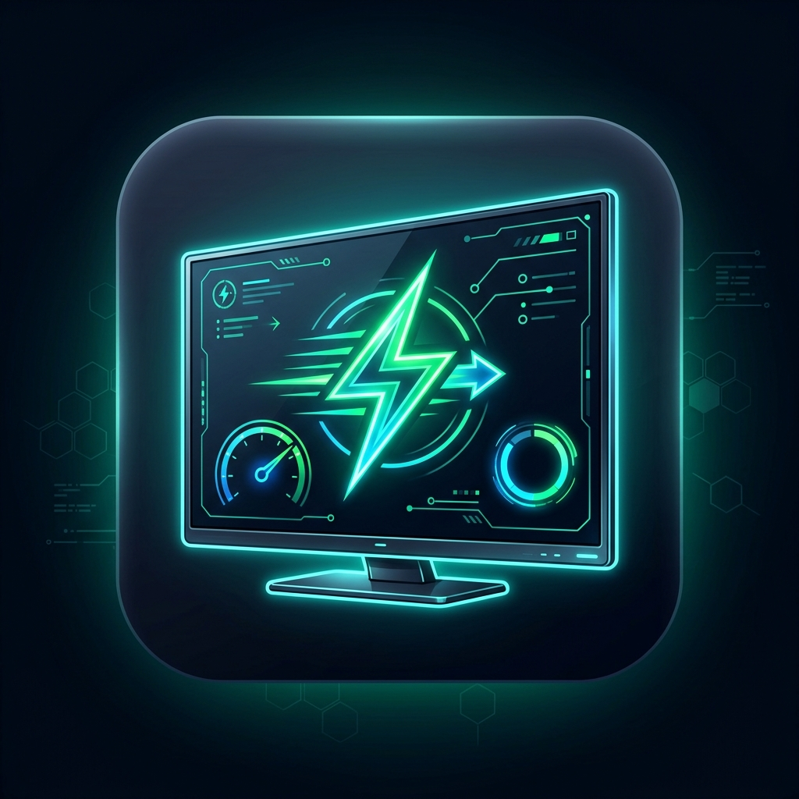

# 🚀 Smart TV Optimizer (Universal Xiaomi & Android TV)

<p align="center">
  
</p>

<p align="center">
  <strong>The Ultimate All-in-One Debloater, Performance Booster & Privacy Guard for Android TV & Google TV.</strong>
</p>

<p align="center">
  <a href="https://github.com/LeonidKoriakovskis/smart-tv-optimizer/releases/latest"></a>
  
  
  
</p>

---

## ⚡ Instant Downloads (Windows)

No command lines or installations required. Download and run:

| Package | Type | Link | Description |
| :--- | :--- | :--- | :--- |
| **Portable `.exe`** | Standalone Executable | [📥 **Download Portable EXE**](https://github.com/LeonidKoriakovskis/smart-tv-optimizer/releases/latest/download/Smart-TV-Optimizer-Portable.exe) | Single `.exe` file. Double-click and run anywhere (USB stick, Desktop). Zero install. |
| **Windows Setup** | Standard Installer | [📥 **Download Windows Installer**](https://github.com/LeonidKoriakovskis/smart-tv-optimizer/releases/latest/download/Smart.TV.Optimizer.Setup.1.0.0.exe) | Installs with Start Menu & Desktop shortcuts. Clean uninstaller included. |

> 💡 **Notice:** Both packages come with **official Google Android Platform-Tools (`adb.exe`) already bundled inside**. You do not need to install Android Studio or SDK tools manually.

---

## ✨ Features at a Glance

* 🎯 **1-Click Optimization Presets:**
  * **🚀 Speed Demon (Recommended):** Disables PatchWall home suggestions, ad daemons, telemetry, trims cache, and sets UI animations to `0.5x`.
  * **🛡️ Balanced & Clean:** Freezes background analytics & trackers while leaving your stock launcher 100% untouched.
  * **⚡ Ultra Minimalist:** Maximum RAM recovery mode; pairs perfectly with lightweight custom launchers.
* 📺 **Xiaomi & PatchWall Specialist:** Specifically designed to silence heavy background daemons on **Mi Box 4 / S / 2nd Gen**, **Mi TV Stick 4K**, and **Xiaomi Smart TVs (A2, P1, Q2, etc.)**.
* 🌐 **Universal Android TV Support:** Also supports **TCL**, **Sony Bravia**, **Philips**, **Chromecast with Google TV**, **Nvidia Shield**, and **Fire OS**.
* 🚀 **1-Click Projectivy Launcher Setup:** Launch the Google Play Store on your TV directly from your computer to install the ad-free Projectivy Launcher with one click.
* ⚡ **Live Hardware Dashboard:** Real-time CPU architecture, Android version, active connection status, and RAM consumption monitors.
* 🛡️ **100% Safe & Reversible (Restore Vault):** Never brick your TV. All debloating is done via user-space package disabling (`pm disable-user --user 0`). Any disabled app can be restored with a single click at any time!
* 🔒 **DRM / Widevine L1 Safe:** Does not unlock the bootloader or modify system partitions. 4K Netflix, Disney+, Prime Video, and Dolby Vision continue to work flawlessly.

---

## 📺 Supported Devices

| Manufacturer / Family | Tested & Supported Models |
| :--- | :--- |
| **Xiaomi / Redmi** | Mi Box 4, Mi Box S (1st & 2nd Gen), Mi TV Stick 4K, Xiaomi TV A2, P1, Q2, Redmi Smart TV series |
| **Google** | Chromecast with Google TV (HD & 4K), Nexus Player |
| **TCL** | TCL Google TV & Android TV Series (C745, C845, P635, etc.) |
| **Sony** | Sony Bravia Android TV & Google TV models |
| **Philips** | Philips Ambilight Android TV series |
| **NVIDIA** | NVIDIA Shield TV & Shield TV Pro |
| **Amazon** | Fire TV Stick 4K / Cube (Developer debugging enabled) |

---

## 📖 Step-by-Step Guide: How to Connect

### 1. Enable Network Debugging on your TV (One-Time Setup)

```
[TV Settings] ➔ [Device Preferences / System] ➔ [About] ➔ Scroll to [Build] ➔ Press OK 7 Times
```

1. Open **Settings** ⚙️ on your TV.
2. Select **Device Preferences** (on Google TV: *System* > *About*).
3. Scroll down to **Build** (or *Android TV OS build*).
4. Tap the center **OK** button on your remote **7 times**. A toast will appear: *"You are now a developer!"*.
5. Go back one menu to **Developer Options**, scroll to **Debugging**, and toggle **USB Debugging** to **ON**.
6. Note down your TV's local IP address (found in **Settings** > **Network & Internet** > Click active Wi-Fi, e.g. `192.168.1.150`).

### 2. Connect via Smart TV Optimizer

1. Open **Smart TV Optimizer** on your PC.
2. Enter your TV's IP address (or click **Scan Wi-Fi** to auto-discover it) and click **Connect to TV**.
3. ⚠️ **Look at your TV screen:** A popup will say *"Allow USB debugging?"*.
4. Check **"Always allow from this computer"** and select **OK** with your remote.
5. The status pill will turn green: `Connected: <IP>:5555`.

### 3. Choose your Preset & Boost!

* Go to **1-Click Presets** and click **Apply Speed Demon**.
* Go to **Speed & Tweaks** and click **Trim RAM Caches** or set animation speed to `0.5x` for butter-smooth navigation!

---

## 🛡️ Safe Restore Vault

If you ever want an app or service back:
1. Open the **Restore Vault** tab.
2. Search or browse any disabled package.
3. Click **Restore**. Your TV will instantly re-enable the package without requiring a reboot.

---

## 🛠️ Developer & Source Build Guide

If you wish to build or run from source:

```bash
# Clone repository
git clone https://github.com/LeonidKoriakovskis/smart-tv-optimizer.git
cd smart-tv-optimizer

# Install dependencies
npm install

# Run Desktop Application (Electron)
npm start

# Run Web-Only Dashboard in Browser
npm run start:web

# Build Windows Standalone Executables
npm run build:portable   # Outputs dist/Smart-TV-Optimizer-Portable.exe
npm run build:installer  # Outputs dist/Smart TV Optimizer Setup 1.0.0.exe
```

---

## 🗺️ Roadmap & Upcoming Features

See our detailed [ROADMAP.md](ROADMAP.md) for upcoming milestones:
- [x] **Track 1:** Standalone Windows Desktop App (`.exe` + NSIS installer)
- [ ] **Track 2:** Android Companion Mobile App (`.apk` for phone & tablet)
- [ ] **Track 3:** Wireless TV D-Pad Remote Controller built right into the app

---

## 📄 License

Distributed under the **MIT License**. See [`LICENSE`](LICENSE) for more information.
