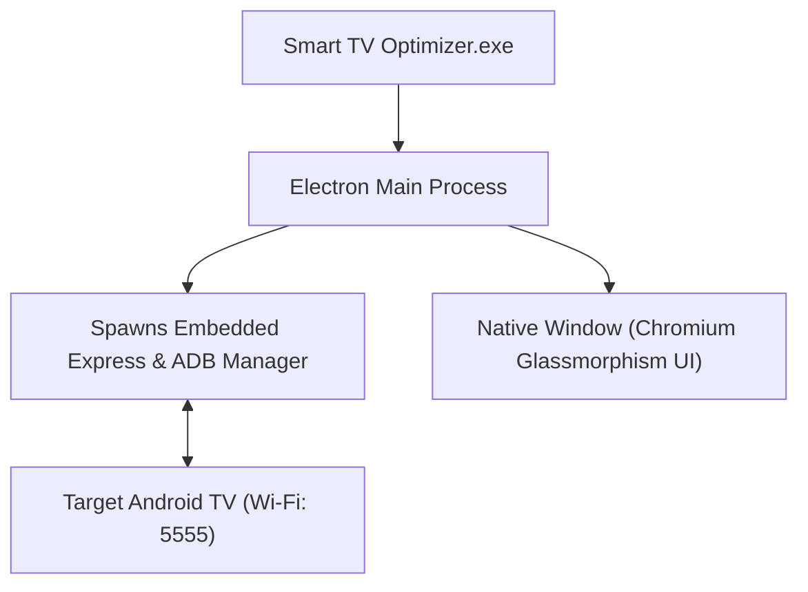
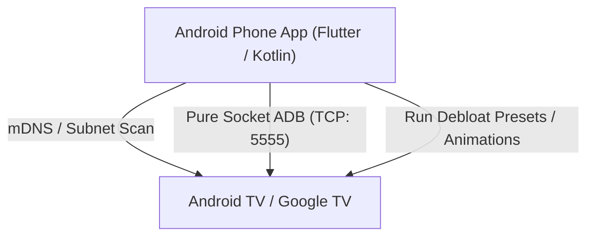

# 🚀 Smart TV Optimizer: Desktop (.exe) & Mobile App Roadmap

This document outlines the step-by-step implementation plan to transition **Smart TV Optimizer** from a local web server into two standalone applications:
1. **Windows Desktop App (`.exe`)** — A native desktop window with no browser tabs or command prompts.
2. **Android Phone App (`.apk`)** — A mobile app to discover and optimize Smart TVs over Wi-Fi directly from your couch.

---

## 🖥️ Track 1: Windows Desktop App (`.exe`)

### Objective
Wrap the existing Express + Web UI into a standalone Windows `.exe` using **Electron** and **electron-builder**.

### 📋 Actionable Checklist

- [x] **Phase 1: Project Setup & Dependencies**
  - [x] Add `electron` and `electron-builder` as dev-dependencies in [`package.json`](file:///c:/Users/leoni/OneDrive/Documents/Projektai/SMART-TV-OPTIMIZER/package.json).
  - [x] Configure `main` entry point in `package.json` pointing to `src/electron-main.js`.

- [x] **Phase 2: Electron Main Process (`src/electron-main.js`)**
  - [x] Create `src/electron-main.js` to manage the app lifecycle.
  - [x] Start the internal Express server silently on an available port.
  - [x] Create a styled `BrowserWindow` (1200x820, dark background, auto-hide menu bar).
  - [x] Gracefully shut down ADB server and child processes on exit.
  - [x] Ensure app paths use `process.resourcesPath` and fallback to `app.getPath('userData')` for ADB storage.

- [x] **Phase 3: Assets & Polishing**
  - [x] Generate high-resolution application icon (`assets/icon.ico` and `assets/icon.png`).
  - [x] Set window and favicon icons with futuristic OLED cyber branding.
  - [x] Disable default Chromium menus and dev shortcuts in production builds.

- [x] **Phase 4: Packaging & Installer Configuration**
  - [x] Configure `electron-builder` in `package.json`:
    - **Portable Target**: Single executable `Smart-TV-Optimizer-Portable.exe` (no installation required).
    - **NSIS Target**: Standard Windows Installer (`Setup.exe`) with desktop & Start menu shortcuts.
  - [x] Bundle pre-downloaded ADB platform-tools inside `extraResources`.

- [x] **Phase 5: Build & Validation**
  - [x] Build portable executable (`dist/Smart-TV-Optimizer-Portable.exe`).
  - [x] Build full Windows NSIS installer (`dist/Smart TV Optimizer Setup 1.0.0.exe`).

---

## 📱 Track 2: Android Phone App (`.apk`)

### Objective
Create a mobile companion app that scans the local Wi-Fi, connects to the TV via an embedded ADB protocol client (no PC or Node.js required), and applies optimizations.

### 📋 Actionable Checklist

- [ ] **Phase 1: Architecture & Tech Stack Selection**
  - [ ] **Recommended Stack**: **Flutter** (for cross-platform dark UI) with a pure TCP ADB library (`adb_client` / `dadb`) or **React Native / Kotlin**.
  - [ ] Set up the Android project structure and network permissions.

- [ ] **Phase 2: Embedded ADB Engine (No PC needed)**
  - [ ] In-app ADB key generator (generates ADB RSA public/private keypair).
  - [ ] Wi-Fi ADB client (TCP socket directly to `tv_ip:5555`).
  - [ ] Handle on-screen TV prompt: *"Allow USB/Network debugging from this device?"*.
  - [ ] Support Android 11+ Wireless Debugging Pairing (Pairing code + 5-digit port) for modern Google TVs.

- [ ] **Phase 3: Port Core Optimization Logic**
  - [ ] Port [`src/catalog.js`](file:///c:/Users/leoni/OneDrive/Documents/Projektai/SMART-TV-OPTIMIZER/src/catalog.js) (Xiaomi, Sony, Philips, TCL, Google TV debloat packages) into mobile-friendly JSON models.
  - [ ] Port subnet scanner / mDNS scanner to auto-discover TVs on the local network.
  - [ ] Implement shell execution queue (`pm disable-user`, `settings put global ...`, `pm trim-caches`).

- [ ] **Phase 4: Mobile UI & User Experience**
  - [ ] Replicate the sleek glowing dark-mode aesthetic for mobile screens.
  - [ ] **Home Screen**: Discovered TVs carousel, 1-tap "Connect" button, quick IP manual entry.
  - [ ] **Dashboard Screen**: TV Model, Android version, RAM / Storage stats cards.
  - [ ] **Presets Screen**: 1-Tap "Safe Debloat", "Gaming / Low Latency", "Speed Boost".
  - [ ] **App Manager Screen**: Filterable package list with toggle switches to freeze/unfreeze any app.

- [ ] **Phase 5: Build & Distribution**
  - [ ] Build release `.apk` (signed with release keystore).
  - [ ] Create GitHub Release page with direct APK download.
  - [ ] Add auto-update check via GitHub API.

---

## ⏱️ Timeline & Effort Comparison

| Task | Estimated Time | Complexity | Dependencies |
| :--- | :--- | :--- | :--- |
| **Windows Desktop `.exe`** | **1 – 2 hours** | Low | Uses 100% of current codebase; only needs Electron wrapper & packager. |
| **Android Phone App (`.apk`)** | **3 – 5 days** | Medium-High | Needs new mobile project, ADB socket protocol implementation, and RSA key exchange. |
